# AWS Certification Journey: Data Science & ML

Este repositório documenta minha jornada de certificações AWS na trilha de **Cientista de Dados / Engenheiro de ML**.
Aqui ficam minhas anotações, labs práticos, registros de simulados e a evolução em Python. É um ambiente de estudo de verdade, versionado do primeiro dia até a última prova.

> **Ponto de partida:** experiência com AWS no dia a dia e domínio de SQL.
> **Objetivo:** ser especialista AWS com foco em dados, Machine Learning e IA Generativa.

---

## Trilha

```mermaid
flowchart LR
    CLF["Cloud Practitioner<br/>CLF-C02"] --> AIF["AI Practitioner<br/>AIF-C01"]
    AIF --> AIB["AI Business Strategist<br/>AIB-C01"]
    AIB --> MLA["ML Engineer<br/>MLA-C01"]
    MLA --> SAA["Solutions Architect<br/>SAA-C03"]
    SAA --> AIP["GenAI Developer Pro<br/>AIP-C01"]
    AIP --> SCS["Security Specialty<br/>SCS-C03"]

    classDef done fill:#1f883d,stroke:#1f883d,color:#fff
    classDef current fill:#ff9900,stroke:#ff9900,color:#000
    classDef planned fill:#6e7781,stroke:#6e7781,color:#fff
    class CLF current
    class AIF,AIB,MLA,SAA,AIP,SCS planned
```



| # | Certificação | Código | Nível | Status | Aprovação | Credencial |
|---|---|---|---|---|---|---|
| 1 | [Cloud Practitioner](certifications/01-cloud-practitioner/) | CLF-C02 | Foundational | 📚 Estudando | — | — |
| 2 | [AI Practitioner](certifications/02-ai-practitioner/) | AIF-C01 | Foundational | 🔜 Planejada | — | — |
| 3 | [AI Business Strategist](certifications/03-ai-business-strategist/) | AIB-C01 | Business | 🔜 Planejada | — | — |
| 4 | [Machine Learning Engineer](certifications/04-machine-learning-engineer/) | MLA-C01 | Associate | 🔜 Planejada | — | — |
| 5 | [Solutions Architect](certifications/05-solutions-architect-associate/) | SAA-C03 | Associate | 🔜 Planejada | — | — |
| 6 | [Generative AI Developer](certifications/06-generative-ai-developer-pro/) | AIP-C01 | Professional | 🔜 Planejada | — | — |
| 7 | [Security](certifications/07-security-specialty/) | SCS-C03 | Specialty | 🔜 Planejada | — | — |

Legenda: 🔜 planejada · 📚 estudando · 📝 simulados · 📅 prova agendada · ✅ aprovado

> Códigos de prova mudam com o tempo. Confirme a versão vigente na página oficial antes de agendar.

---

## Estrutura do repositório

```
.
├── certifications/
│   ├── 01-cloud-practitioner/
│   │   ├── README.md            # informações da prova, domínios, progresso do curso
│   │   ├── notes/               # uma nota por seção do curso
│   │   ├── labs/                # hands-on na minha conta AWS (com limpeza de recursos)
│   │   ├── practice-exams/      # registro de simulados e pontos fracos
│   │   └── course-materials/    # slides e código do curso (local, fora do git)
│   └── 02-.../ ... 07-.../      # próximas certificações
├── python/                      # trilha de Python para dados (ponte SQL → pandas → boto3)
├── templates/                   # modelos de nota, lab e simulado
├── scripts/                     # utilitários (ex.: check_env.py)
└── docs/                        # setup, método de estudo e guia de Git
```

## Como estudo

O ciclo de cada seção: **assistir → anotar → praticar → revisar → commitar**. Os detalhes estão em [docs/study-method.md](docs/study-method.md).

- Cursos do **Stephane Maarek** (Udemy) como base teórica
- **Simulados** (Udemy + AWS Skill Builder) até passar de 80% com consistência
- **Labs** em uma conta AWS pessoal, com alerta de custo e limpeza documentada
- **Python aplicado**: cada certificação de IA/ML vira prática com `boto3`, `pandas` e notebooks

## Ambiente

Python 3.13 · Jupyter Lab · boto3 · pandas · AWS CLI v2 · Git

Passo a passo de configuração em [docs/setup.md](docs/setup.md). Para validar o ambiente:

```powershell
python scripts/check_env.py
```

---

<sub>O material dos cursos (slides, vídeos, código) pertence aos seus autores e **não** está neste repositório. Aqui estão apenas minhas anotações e meus labs.</sub>
